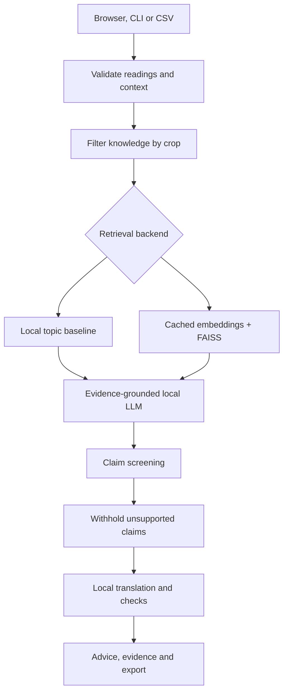

# Architecture

CropAdvisory is a local Python application with a static browser interface and a shared inference pipeline. Browser requests and CLI/batch requests use the same `advise()` function.



The evidence-only mode bypasses generation, claim review and translation and displays English source guidance. It is for setup demonstrations and testing the retrieval plumbing.

## Module responsibilities

| Module | Responsibility |
| --- | --- |
| `app.py` | HTTP handling, loopback binding, request limits and static assets |
| `crop_advisory/engine.py` | Input validation, sensor-to-text prompts, Ollama client, translation orchestration |
| `crop_advisory/retrieval.py` | Crop isolation, topic baseline, optional cached semantic index |
| `crop_advisory/verification.py` | Atomic sentence screening, cautious model review, withholding |
| `crop_advisory/sensors.py` | CSV ingestion and sensor-ID-based history checks |
| `crop_advisory/quality.py` | Unit normalization, timestamp/calibration/fault states and weather freshness |
| `crop_advisory/applicability.py` | Crop, region, season, production-system and date screening |
| `crop_advisory/translation.py` | Unit guards and local semantic translation review |
| `crop_advisory/resources.py` | Optional sampled RAM/GPU and RAPL energy |
| `crop_advisory/statistics.py` | Confidence intervals, paired bootstrap and kappa |
| `crop_advisory/research_pipeline.py` | Research-only direct multilingual arm |
| `scripts/benchmark.py` | Real measurement collection and human review export |
| `web/` | Form, result rendering and JSON download |

## Why a layered local architecture?

Validation, retrieval and model calls can be tested independently. Reusing the same pipeline prevents the web demo from drifting away from the evaluation code. A local model service keeps large weights outside the application and lets the same model family run at different quantizations without rewriting inference code. Crop metadata allows adding knowledge without copying the entire application.

The default retrieval baseline is appropriate for the tiny bundled knowledge base and works without downloads. The optional semantic backend retains the project's MiniLM/FAISS RAG approach. Neither system may retrieve another crop's records.

## API

`GET /api/health` checks the web server; it does not assert that Ollama is available.

`GET /api/models` queries local Ollama's installed model list. A 503 response means model service access failed.

`POST /api/advice` accepts:

```json
{
  "crop": "rice",
  "moisture": 32,
  "temperature": 29,
  "ph": null,
  "region": "Tamil Nadu",
  "soil_type": "clay",
  "growth_stage": "panicle initiation",
  "symptoms": "",
  "question": "What should guide water management?",
  "language": "hi",
  "mode": "llm",
  "model": "llama3.2:3b",
  "prompt_style": "structured"
}
```

Moisture is calibrated % VWC; temperature is air °C. Null or blank readings are unknown. At least one question, symptom or reading is required. pH must be 0–14, VWC 0–100, and temperature within the broad input plausibility bounds of -20–70 °C. These validation bounds are **not crop suitability thresholds**.

A successful response includes normalized input, raw sensor audit records, quality warnings, a structured summary, screened English answer, optional translation, source applicability/exclusions, per-claim assessments, withheld-claim count and inference metadata. Translation failures preserve English with a withheld/unavailable translation status. `draft` preserves the unfiltered model output **for auditing only**, not recommended action. 400 indicates invalid input; 503 indicates an unavailable model/service or invalid model output.

## Verification limits

The reviewer may be the same local model as the generator, so correlated errors are possible. Rule matches cover only a small set of risks. Exact source extracts are treated as supported by that source, which does not establish current local applicability. Semantic support labels are model judgements and can be wrong. Unsupported claims are withheld, and the result can fall back to extracts. Source URLs and the knowledge `verified` flag indicate provenance review, not blanket approval of generated claims.

## Offline boundary

No CDN assets, cloud model APIs or remote embedding downloads are required during normal inference. Optional source links open external sites only when the user selects them. Ollama itself must be configured with local weights; cloud model use is rejected by the application. Initial dependency/model provisioning and source updates require connectivity. Physical sensor capture and expert review remain deployment activities, not features demonstrated by synthetic CSV samples.

## Measurement and weather metadata

Use `timestamp` and `calibrated` for shared reading metadata, or override per field with `moisture_timestamp`, `temperature_timestamp`, `ph_timestamp` and the corresponding `_calibrated` fields. Timestamps require ISO-8601 time zones. Defaults are 24 hours for reading freshness and five minutes of tolerated clock skew. These are configurable data-quality policies, not crop-action thresholds. `sensor_faults` accepts an object or use flat `moisture_fault`, `temperature_fault`, `ph_fault` fields in CSV.

`moisture_unit` accepts `% VWC` or `fraction`/`m3/m3`; `temperature_unit` accepts °C or °F. Raw sensor percentages are not supported. Normalization precedes plausibility checks.

Weather fields are `rainfall_24h_mm`, `forecast_rainfall_mm`, `humidity`, `weather_timestamp`, `weather_source` and `weather_notes`. There is no live API dependency. Future/stale data remains auditable but is removed from decision values.

Source context additionally accepts `season`, `production_system` and `max_source_age_days`. Unknown dates and region/season coverage remain warnings; explicit mismatches and expiry exclude a reference. Region matching is conservative text/metadata matching, not a GIS lookup or agronomist confirmation.

`prompt_style` now supports `structured`, `unstructured` and `concise`. The unstructured baseline changes input representation while retaining structured-arm output instructions. The direct multilingual comparison arm is available only through the research benchmark.
